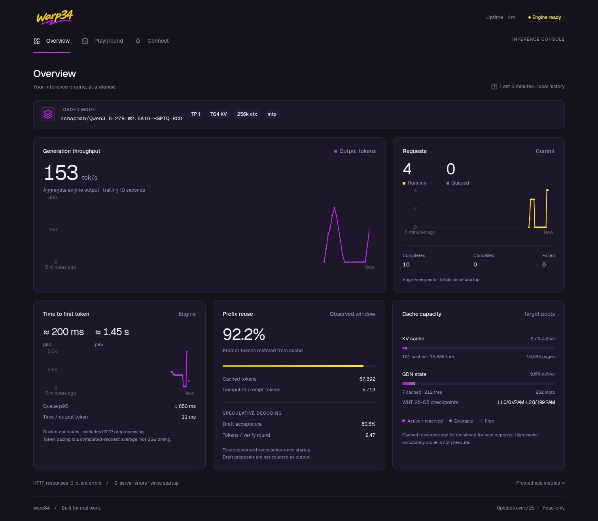

# warp34

A [fast](#performance) single-binary inference engines for **Qwen 3.5, 3.6, 3.8, and Flash-Next** on NVIDIA GPUs—outperforming `vLLM`, `SGLang`, and `llama.cpp` across prefill, decode, continuous batching, and long-context coding agents.

[](https://github.com/nchapman/warp34/actions/workflows/docker.yml)
[](LICENSE)
[](docs/HARDWARE.md)
[](https://huggingface.co/nchapman/models)

[Quickstart](#quickstart) · [Models](#pick-a-model-for-your-gpu) · [Performance](#performance) · [APIs & Agents](#apis--coding-agents) · [Docs](#documentation)

Written in Rust and CUDA with zero Python and zero NCCL. Built specifically for Qwen's hybrid Gated DeltaNet + full-attention architecture on RTX 30-series (`sm_86`), RTX 40-series (`sm_89`), and A100 (`sm_80`) GPUs.



---

## Quickstart

**Requirements:** Linux `x86_64` (AVX2/FMA), an NVIDIA RTX 30/40-series or A100 GPU, and a CUDA 13-capable driver (R580+).

### Docker (fastest)

Requires [NVIDIA Container Toolkit](https://docs.nvidia.com/datacenter/cloud-native/container-toolkit/latest/install-guide.html):

```sh
docker run --rm --gpus all -p 127.0.0.1:8000:8000 \
  -v ~/.cache/huggingface:/root/.cache/huggingface \
  ghcr.io/nchapman/warp34:latest \
  serve nchapman/Qwen3.8-27B-W4A16-HGPTQ
```

### Build from source

Requires CUDA 13.4 (`/usr/local/cuda` or `/opt/cuda`) and [mise](https://mise.jdx.dev/):

```sh
git clone https://github.com/nchapman/warp34.git && cd warp34
mise install && mise run build
./target/release/warp34 serve nchapman/Qwen3.8-27B-W4A16-HGPTQ
```

*(Tip: set `WARP34_ARCH=sm_89` / `sm_86` / `sm_80` before `mise run build` to compile only your GPU arch.)*

### Verify

`warp34 serve` downloads the checkpoint, auto-fits `tq4` KV context (up to `256K`), and enables `MTP-3` speculation automatically:

```sh
curl -fsS http://127.0.0.1:8000/v1/chat/completions \
  -H 'Content-Type: application/json' \
  -d '{
    "model": "nchapman/Qwen3.8-27B-W4A16-HGPTQ",
    "messages": [{"role": "user", "content": "Say hello in one sentence."}],
    "max_tokens": 64
  }'
```

Open **`http://127.0.0.1:8000/`** for the live dashboard, **`/playground`** to test every API, and **`/connect`** for copy-paste coding-agent configs. Pass `--no-webui` for an API-only server.

---

## Highlights

- **Purpose-built CUDA kernels:** Shared-weight `W4A8`/`W2A8` INT8 IMMA prefill, Marlin quantized decode, fused GDN recurrence, and lossless `MTP-3` / `DFlash2` speculation.
- **Zero-config VRAM & long context:** Built-in 4-bit TurboQuant KV (`tq4`, 3.07× compression) and an automatic memory planner fit Vision, `MTP-3`, and `128K–256K` context on one card with zero flags.
- **180B `Qwen3.8-Flash-Next` on 1–2 consumer GPUs:** Streams n-gram tables via `mmap`, caches hot experts in VRAM, prefetches cold experts over PCIe, and evaluates misses on AVX-512/AVX2 CPU.
- **All APIs in one binary:** OpenAI Chat/Completions, OpenAI Responses, Anthropic Messages (with `<think>`-aware XGrammar structured outputs & tool constraints), and zero-decode `/v1/systemone` & `/v1/decisions` classifiers.
- **Multi-GPU & Multi-LoRA:** Native `TP=2`/`TP=4` without NCCL or `--ipc=host`, plus up to **62 hot-swappable LoRA adapters** (`--lora-modules`).

---

## Pick a Model for Your GPU

All checkpoints below come from [`nchapman/models`](https://huggingface.co/nchapman/models) and run with **zero extra flags** (`warp34 serve <model>`). Standard upstream `FP16`/`BF16`, `GPTQ`, `AWQ`, `AutoRound`, and `compressed-tensors` Qwen checkpoints also work out of the box—see [`docs/MODELS.md`](docs/MODELS.md) and [`docs/HGPTQ.md`](docs/HGPTQ.md).

| GPU VRAM | Recommended Checkpoint (`nchapman/...`) | Footprint (`128K tq4`) | Notes |
|---|---|---:|---|
| **8 GB** | `Qwen3.5-9B-W2.6A16-HGPTQ-RCO` | `6.0 GiB` | Vision + `MTP-3` + `128K` on 8 GB |
| **12 GB** | `Qwen3.5-9B-W4A16-HGPTQ` | `8.6 GiB` | Full 4-bit quality; alt: `Qwen3.8-27B-W2.2A16-HGPTQ-RCO` (`64K`) |
| **16 GB** | `Qwen3.8-27B-W2.6A16-HGPTQ-RCO` | `14.6 GiB` | Flagship 27B; fast MoE alt: `Qwen3.6-35B-A3B-W2.6A16-HGPTQ-RCO` |
| **1× 24 GB** | `Qwen3.8-27B-W4A16-HGPTQ` | `~19 GiB` | Flagship 27B (`128K–256K`); also fits `35B-A3B` W4 or `180B Flash-Next` W2.6 |
| **2× 24 GB** (`--tp 2`) | `Qwen3.8-Flash-Next-W2.6A16-HGPTQ-RCO` | `20.8 GiB/GPU` | Flagship 180B MoE + `128K–256K` + `MTP-3` / `DFlash2` |

---

## Performance

### `Qwen3.5-9B` (`MTP-3`) vs. `vLLM`, `SGLang`, and `llama.cpp`

End-to-end HTTP serving p50 (`tok/s`, `FP16` KV) on **`1× RTX 3090 Ti`**:

| Workload | **`warp34`** | `vLLM 0.34.0` | `SGLang v0.5.23` | `llama.cpp` | `warp34` lead |
|---|---:|---:|---:|---:|---:|
| **Cold 4K prefill** | **`8,223`** | `4,801` | `4,539` | `4,892` | **`+68%–81%`** |
| **Cold 115K prefill** | **`4,097`** | `2,875` | `2,885` | `3,124` | **`+31%–43%`** |
| **Single-stream decode (`C=1`)** | **`233.5`** | `180.6` | `179.2` | `194.4` | **`+20%–30%`** |
| **Batched decode (`C=16`)** | **`1,346.4`** | `1,276.8` | `881.5` | *crash* | **`+5%–53%`** |
| **Coding agent (`64K` ctx)** | **`42.3`** | `22.9` | `27.2` | `31.8` | **`+33%–85%`** |
| **Coding agent (`120K` ctx)** | **`19.5`** | `11.2` | `13.2` | `15.1` | **`+29%–74%`** |

On **`2× RTX 3090 Ti` PCIe**:

| Workload | **`warp34`** | `vLLM 0.34.0` | `SGLang v0.5.23` | `llama.cpp` | `warp34` lead |
|---|---:|---:|---:|---:|---:|
| **Cold 4K prefill** | **`8,408`** | `5,282` | `5,044` | `4,169` | **`+59%–102%`** |
| **Cold 115K prefill** | **`5,492`** | `3,902` | `3,742` | `3,119` | **`+41%–76%`** |
| **Single-stream decode (`C=1`)** | **`338.6`** | `232.6` | `251.4` | `217.0` | **`+35%–56%`** |
| **Batched decode (`C=16`)** | **`1,675.8`** | `1,354.0` | `1,264.5` | *crash* | **`+24%–33%`** |
| **Coding agent (`64K` ctx)** | **`49.8`** | `27.5` | `34.1` | `30.5` | **`+46%–81%`** |
| **Coding agent (`120K` ctx)** | **`26.4`** | `14.2` | `17.2` | `15.2` | **`+53%–86%`** |

*Details & methodology: [`docs/BENCHMARKS.md`](docs/BENCHMARKS.md#head-to-head-qwen35-9b-mtp-3-vs-vllm-sglang-and-llamacpp).*

### vs. specialized consumer-GPU engines

End-to-end HTTP serving p50 (`tok/s`, `W4A16-HGPTQ`):

| Engine | Specialty | Workload | Competitor | **`warp34`** | `warp34` lead |
|---|---|---|---:|---:|---:|
| **[`ninfer-3090`](https://github.com/Don-Chad/ninfer-3090)** | `27B` `1× 3090 Ti` *(MTP)* | `C=1` / `C=8` / agent / primed | `94.1` / `260.3` / `69.2` / `39.8` | **`109.1` / `417.2` / `96.0` / `109.6`** | **`+16%` – `2.75×`** |
| **[`qwen38-flash-next-3090`](https://github.com/DominikBucko/qwen38-flash-next-3090)** | `180B` `1× 3090 Ti` *(MTP)* | chat / `6K` code / primed | `30.6` / `21.2` / `10.2` | **`53.7` / `26.3` / `49.6`** | **`+24%` – `4.86×`** |
| **[`qwen38-flash-next-2x3090`](https://github.com/DominikBucko/qwen38-flash-next-2x3090)** | `180B` `2× 3090 Ti` *(MTP)* | chat / `6K` code / primed | `55.6` / `28.3` / `20.5` | **`99.4` / `39.1` / `93.1`** | **`+38%` – `4.54×`** |
| **[`Strata v0.2.17`](https://github.com/Niko1221/Strata)** | `180B` `1× 3090 Ti` *(DFlash2)* | chat / prefill / primed / agent | `80.9` / `23.6` / **`82.9`** / **`64.7`** | **`83.9`** / **`32.1`** / `74.0` / `58.4` | **`+4%` / `+36%`; `-10%` primed/agent** |
| **[`Strata v0.2.17`](https://github.com/Niko1221/Strata)** | `180B` `1× 4090` *(DFlash2)* | chat / prefill / primed / agent | `118.0` / `40.3` / `109.4` / `98.0` | **`120.0` / `49.0` / `118.6` / `101.1`** | **`+2%` – `+22%`** |
| **[`Strata v0.2.17`](https://github.com/Niko1221/Strata)** | `180B` `2× 3090 Ti` *(DFlash2)* | chat / prefill / primed / agent | `120.9` / `37.1` / `112.8` / `96.1` | **`140.1` / `51.0` / `123.5` / `123.6`** | **`+10%` – `+38%`** |
| **[`Strata v0.2.17`](https://github.com/Niko1221/Strata)** | `180B` `2× 4090` *(DFlash2)* | chat / prefill / primed / agent | `132.7` / `51.1` / `113.1` / `112.6` | **`179.6` / `68.5` / `178.7` / `184.7`** | **`+34%` – `+64%`** |

*Competitor configs, commits, & `W2.6-RCO` numbers: [`docs/BENCHMARKS.md`](docs/BENCHMARKS.md#head-to-head-vs-specialized-consumer-gpu-engines-12-rtx-3090-ti--12-rtx-4090).*

### Single-stream decode across Q4 models (`W4A16-HGPTQ` + `MTP-3`)

| Model | 1× RTX 3090 Ti | 1× RTX 4090 | 2× RTX 3090 Ti | 2× RTX 4090 |
|---|---:|---:|---:|---:|
| **`Qwen3.5-9B`** | `234 tok/s` | `253 tok/s` | `339 tok/s` | `369 tok/s` |
| **`Qwen3.8-27B`** | `150 tok/s` | `162 tok/s` | `252 tok/s` | `246 tok/s` |
| **`Qwen3.6-35B-A3B`** | `429 tok/s` | `512 tok/s` | `553 tok/s` | `672 tok/s` |
| **`Qwen3.8-Flash-Next`** *(180B)* | `54 tok/s` *(DFlash2 `84`)* | `58 tok/s` *(DFlash2 `120`)* | `99 tok/s` *(DFlash2 `140`)* | `117 tok/s` *(DFlash2 `180`)* |

*`W2.6-RCO` vs. `W4A16`, budget GPUs (8–16 GB), & measurement notes: [`docs/BENCHMARKS.md`](docs/BENCHMARKS.md#single-stream-decode-across-q4-models-w4a16-hgptq--mtp-3).*

---

## APIs & Coding Agents

A single `warp34 serve` instance speaks all protocols simultaneously with shared hybrid prefix caching:

- **OpenAI:** `/v1/chat/completions`, `/v1/completions`, `/v1/responses`
- **Anthropic:** `/v1/messages`, `/v1/messages/count_tokens` (native `thinking` + `tool_use`, strips Claude Code billing headers so prefix caches stay warm)
- **Decisions:** `/v1/systemone`, `/v1/decisions` (single-prefill zero-decode classification)
- **UI & Metrics:** `/` dashboard, `/playground`, `/connect`, `/metrics` (Prometheus)

Connect **Claude Code** directly (or open `http://127.0.0.1:8000/connect` for Codex CLI, OpenCode, Pi, Aider, and SDK snippets):

```sh
ANTHROPIC_BASE_URL=http://127.0.0.1:8000 \
ANTHROPIC_AUTH_TOKEN=warp34 \
claude --model "nchapman/Qwen3.8-27B-W4A16-HGPTQ"
```

Common flags (`--tp 2`, `--draft-model`, `--lora-modules`, `--api-key-env`, `--offline`, Docker non-root/multi-GPU) and terminal chat (`warp34 chat`) are documented in [`docs/SERVING.md`](docs/SERVING.md).

---

## Scope & Limitations

- **Qwen hybrid family only:** Qwen 3.5 / 3.6 / 3.8, `Qwen3.8-Flash-Next`, and `GLiDE`/`d3` decision models. For Llama, Mistral, Gemma, or DeepSeek, use `vLLM`, `SGLang`, or `llama.cpp`.
- **Hardware & OS:** Linux `x86_64` with NVIDIA RTX 30-series (`sm_86`), RTX 40-series (`sm_89`), or A100 (`sm_80`). No macOS, Windows, ROCm, or pre-Ampere support.
- **Single-node only:** Supports `TP=1`, `TP=2`, and `TP=4` on one machine; multi-node distributed serving is out of scope.

---

## Documentation

- **Using `warp34`:** [Benchmarks](docs/BENCHMARKS.md) · [Models & Quantization](docs/MODELS.md) · [HGPTQ & W2.6-RCO](docs/HGPTQ.md) · [Serving & CLI](docs/SERVING.md) · [Flash-Next 180B](docs/QWEN_FLASH_NEXT.md)
- **APIs:** [OpenAI & Anthropic Wire Contracts](docs/GENERATIVE_APIS.md) · [Structured Outputs & Tools](docs/STRUCTURED_OUTPUTS.md) · [Decision APIs](docs/DECISION_MODELS.md) · [Metrics & Dashboard](docs/METRICS.md)
- **Internals:** [Architecture & Roadmap](docs/ROADMAP.md) · [GPU Hardware Guide](docs/HARDWARE.md) · [Feature Inventory](docs/FEATURES.md) · [Benchmark Harness](benchmarks/perf/README.md)

---

## Development & License

```sh
mise run check-quick   # fmt + clippy (cuda & cpu) + rustdoc + SIMD & CUDA binary gates
mise run test-quick    # fast GPU unit tests
mise run check         # full release gate + compute-sanitizer
```

Contributions are welcome—see [`CONTRIBUTING.md`](CONTRIBUTING.md). Built on ideas and reference designs from [vLLM](https://github.com/vllm-project/vllm), [Marlin](https://github.com/IST-DASLab/marlin), [SGLang](https://github.com/sgl-project/sglang), [`vllm.cpp`](https://github.com/localai-org/vllm.cpp), [TurboQuant](https://arxiv.org/abs/2504.19874), [`qwen38-flash-next-2x3090`](https://github.com/DominikBucko/qwen38-flash-next-2x3090), and [`Strata`](https://github.com/Niko1221/Strata).

Licensed under the [Apache License 2.0](LICENSE). See [`NOTICE`](NOTICE) for third-party attributions.
